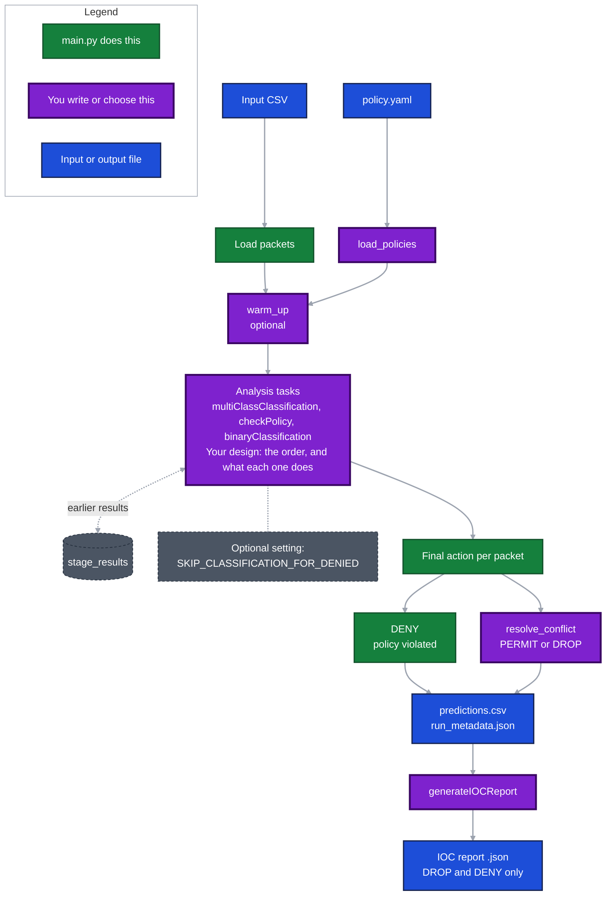

# Final Project: Packet Analysis Pipeline

## Overview

Build a pipeline that takes a CSV file of network packets (one row per packet) and performs four tasks:

- **Multi-class classification.** Predict, for every packet, its attack category. `Normal` means **PERMIT**; any other category means **DROP**.
- **Policy checking.** Decide, for every packet, whether it violates any of the given policies. A packet that violates a policy is **DENY**.
- **Binary classification.** Predict, for every packet, whether it is normal (`0`) or an attack (`1`). Normal means **PERMIT**; attack means **DROP**.
- **IOC report.** Generate a report from the results of multi-class classification, policy checking and binary classification.

Every packet receives one final action:

- **DENY** if it violates any policy. DENY always takes precedence over PERMIT and DROP.
- Otherwise **PERMIT** or **DROP**, decided by your own rule for combining the two classification results.

Provided separately:

- the labelled dataset,
- the policy document (`policy.yaml`).

## The dataset

The packets come from the UNSW-NB15 dataset. We use **all** of its formats and possible values exactly as they are provided in UNSW-NB15, without cleaning or converting them for you. Your pipeline must handle every format and value that can appear in any column, including the port, protocol and category columns.

The labelled dataset has three ground-truth columns, which are removed before your pipeline runs:

| Column | Meaning |
|---|---|
| `Label` | `0` if the packet is normal, `1` if it is an attack. This is what binary classification predicts. |
| `attack_cat` | The attack category of the packet. This is what multi-class classification predicts. |
| `verdict` | The expected final action for the packet: `DENY`, `PERMIT` or `DROP`. |

**DoS has been removed as a category for the final project.** We discussed DoS in the earlier assignments and recognize the limitations of that category in this dataset, so it is not one of the categories you predict.

Some packets have `-` in the `sport` or `dsport` column instead of a number. Most are ARP packets, which have no ports, and a few are TCP or UDP packets. Your pipeline must handle these rows without failing. In the IOC report, use the string `"-"` for `src_port` or `dst_port` when the column is `-`.

Hint: ports may also appear in hexadecimal, for example `0x000b`. Convert them to integers for the IOC report and for policy checking.

## How your work is graded

Your pipeline is graded on three parts: detection, the IOC report and efficiency. Detection and the IOC report are each scored on three test datasets, and the realistic dataset carries the most weight because it is closest to the traffic a deployed pipeline would see.

| Part | Points | Normal dataset | Attack dataset | Realistic dataset |
|---|---:|---:|---:|---:|
| Detection | 60 | 15 | 15 | 30 |
| IOC report | 30 | 5 | 10 | 15 |
| Efficiency | 10 | | | |

- **Normal dataset:** normal traffic only.
- **Attack dataset:** attack traffic only.
- **Realistic dataset:** a mix of normal and attack traffic in proportions close to real network traffic.

**Detection** is scored on the final result only. For every packet, your pipeline's final action (DENY, PERMIT or DROP) is either correct or incorrect, and your detection score on each dataset is the share of packets whose final action is correct. The predictions of the individual tasks are not scored on their own.

**The IOC report** is compared against the course's own reports, including the category, severity, policy rule and summary of each entry. An IOC report that cannot be parsed scores zero.

**Efficiency** is measured on the course hardware, so that every submission is compared fairly. It combines the memory your pipeline uses, the average number of packets it processes per second, and its processor/GPU usage. Everything your pipeline does counts toward efficiency, including `warm_up()`.

Deciding where the balance between accuracy and efficiency lies is part of the project.

## Testing your pipeline locally

We give you tools to test your pipeline on your own machine, so that you can see how it performs while you build it. These tools are for your own iteration. They are not a grade, and a local result does not guarantee the same result on the portal.

### Building your own test sets

You need your own labelled test sets to test locally. Build them in the dataset format, with the `Label`, `attack_cat` and `verdict` columns, for example by selecting rows from the provided 30k CSV or from other UNSW-NB15 and similar data:

- a **normal** set with normal traffic only;
- an **attack** set with attack traffic only;
- a **realistic** set mixing normal and attack traffic in proportions you consider close to real network traffic.

The provided 30k CSV is a small, poorly structured set with limited coverage of the traffic your pipeline will face. Do not rely on it alone: look for more UNSW-NB15 and similar data to build test sets that reflect each kind of traffic.

### Detection benchmark

`benchmark.py` runs your whole pipeline through `main.py`, exactly as grading does, and prints your detection accuracy on each test set you give it, computed the same way grading computes it:

    python benchmark.py --normal normal.csv --attack attack.csv --realistic realistic.csv --policies policy.yaml --output benchmarkRun

You may give one, two or all three sets. When you give all three, it also prints an estimate of your detection score out of 60, weighted as in [How your work is graded](#how-your-work-is-graded). Start with small sets while you are still changing your pipeline, then run larger ones once it is stable.

### Individual tasks

You can also run `multiClassClassification.py`, `checkPolicy.py` and `binaryClassification.py` on their own (see the usage line at the top of each file). Each one checks its output against the interface requirements that `main.py` enforces and, if the CSV has the matching ground-truth column, prints accuracy, precision, recall and F1 for that task. These task scores are for your own diagnosis, to find which task is pulling your final result down. Grading scores only each packet's final action.

### IOC report format check

`generateIOCReport.py` can be run on its own to check that your report can be read by the grader:

    python generateIOCReport.py --input labelled.csv --policies policy.yaml --output reportCheck

It runs your whole pipeline, then checks every entry against the required format, and checks that the report agrees with your own `predictions.csv` (one entry per DROP or DENY packet, with the matching verdict, category, policy rule, severity and packet fields).

**This check is not a grade on the quality of your IOC report.** It tells you only that the report is well formed and consistent with your own predictions. The IOC report is graded only on the portal, where it is compared against the course's own reports.

### What cannot be tested locally

- **The IOC score.** It is graded only on the portal.
- **The efficiency score.** It is measured only on the course hardware. The timings in `run_metadata.json` are useful for comparing two versions of your own pipeline on your own machine, but your machine is not the grading machine.

## Your design is your choice

You decide how your pipeline works. The sequence of the tasks, the flow of data between them, the approach used for each task, and the way the results are combined are all for you to work out and justify. For example, a task that runs later may use the results of tasks that ran earlier (see [Shared context](#shared-context)). We measure the final result, not the route you took to it, as long as you stay within the rules below.

## How the pipeline fits together

The chart shows where each part of the pipeline runs and when. `main.py` loads the data, decides each packet's final action and writes the outputs, while you choose the order of the three analysis tasks and write how each of them works.



You set the order of the analysis tasks in `PIPELINE_ORDER`, and each task can read the results of the tasks that ran before it through `context["stage_results"]` (see [Shared context](#shared-context)). A packet that violates a policy is DENY, regardless of what the classifiers would have said. Every packet that is not denied receives PERMIT or DROP from your `resolve_conflict()` rule. `SKIP_CLASSIFICATION_FOR_DENIED` is described under [Interface requirements](#interface-requirements).

## What you need to do

- Implement each task in its module of the starter template, meeting the [interface requirements](#interface-requirements).
- In the `STUDENT CONFIG` block of `main.py`, set the order of the analysis tasks and the other settings, implement your rule for combining the two classification results, and describe that rule.
- Generate the IOC report in the [required format](#ioc-report-format).
- If your pipeline uses trained models, follow the rules in [Trained models](#trained-models).
- List every package your pipeline needs in `requirements.txt`, with a pinned version (see [Python version and packages](#python-version-and-packages)).
- Check that your pipeline runs from a fresh Python environment with the command in [How your pipeline is run](#how-your-pipeline-is-run).
- Submit your completed template folder as described in [What to submit](#what-to-submit).

## Starter template

| File | Purpose | Your work |
|---|---|---|
| `main.py` | Orchestrator: runs the pipeline and writes the outputs | Edit the `STUDENT CONFIG` block only |
| `multiClassClassification.py` | Multi-class classification | Implement `classify_multiclass()` |
| `checkPolicy.py` | Policy checking | Implement `check_policy()`; `load_policies()` may be changed |
| `binaryClassification.py` | Binary classification | Implement `classify_binary()` |
| `generateIOCReport.py` | IOC report | Implement `generate_report()` |
| `warmUp.py` | Optional one-off setup before the tasks run | Implement `warm_up()` if needed |
| `benchmark.py` | Local detection benchmark (see [Testing your pipeline locally](#testing-your-pipeline-locally)) | Local testing only. Do not upload. |
| `requirements.txt` | Python dependencies, with pinned versions | Uncomment every package your pipeline needs |
| Your model files | Trained models, if your pipeline uses any, saved next to the template files | Add your model files, named as in [What to submit](#what-to-submit) (there is no `models/` folder) |

## Python version and packages

Your pipeline is run with **Python 3.12**. The starter `requirements.txt` lists every package you may use, each pinned to the version to use. Uncomment the ones your pipeline needs and keep their versions. `numpy` and `pandas` are already uncommented because `main.py` needs them.

Only the packages listed in your `requirements.txt` are installed when your submission is run. A model saved with one version of a package may not load with another, so train and save your models with the same versions that you list.

If your pipeline uses an LLM, `requirements.txt` contains commented-out lines for `llama-cpp-python` that install a prebuilt CPU build. Uncomment them if you need them.

## How your pipeline is run

Your submission is run with exactly this command:

```
python main.py --input <packets.csv> --policies <policy.yaml> --output <output_dir>
```

- The input CSV has the same feature columns as the labelled dataset.
- The ground-truth columns `Label`, `attack_cat` and `verdict` are removed before any of your code runs.
- Every packet is given a `packet_id`: its 0-based row number in the input CSV. This replaces any `packet_id` column already in the file.
- The run writes these files to `<output_dir>`:
  - `predictions.csv`: one row per packet, with the outputs of the three analysis tasks and the final action;
  - `run_metadata.json`: task order, settings, final action counts, timings, the list of model files in your submission folder, and any extra files that are not part of a production-ready submission;
  - your IOC report file(s).

## Interface requirements

`main.py` checks the output of every analysis task. If an output does not meet its requirements, the run stops with an error.

### `main.py`

You may edit **only** the `STUDENT CONFIG` block:

| Setting | Requirement |
|---|---|
| `PIPELINE_ORDER` | Required. Any order of `"multiclass"`, `"policy"` and `"binary"`, each exactly once. The template leaves it empty, and `main.py` stops with an error until you set it. For example, `PIPELINE_ORDER = ["multiclass", "binary", "policy"]` would start with multiclass first. |
| `RUN_WARM_UP` | `True` or `False`. Controls whether `warm_up()` is called. |
| `SKIP_CLASSIFICATION_FOR_DENIED` | `True` or `False`. If `True`, any classifier that runs after `checkPolicy` only receives the packets that were not denied. Denied packets never reach that classifier. |
| `resolve_conflict()` | Called only for packets that were not denied. Must return `"PERMIT"` or `"DROP"`. |
| `CONFLICT_RULE_DESCRIPTION` | Required. Describe the rule implemented in `resolve_conflict()` and justify it. |

### `multiClassClassification.py`

`classify_multiclass(packets, context)` must return a pandas DataFrame with exactly one row per input packet and these columns:

| Column | Values |
|---|---|
| `packet_id` | Copied from the input |
| `attack_cat_pred` | One of `Normal`, `Generic`, `Exploits`, `Fuzzers`, `Reconnaissance`, `Analysis`, `Backdoor`, `Shellcode`, `Worms` (exact spelling). DoS is not a category in this project. |
| `multiclass_confidence` | A number in [0, 1], or NaN/None if not available |

### `checkPolicy.py`

`check_policy(packets, context)` must return a pandas DataFrame with exactly one row per input packet and these columns:

| Column | Values |
|---|---|
| `packet_id` | Copied from the input |
| `policy_decision` | `"DENY"` or `"ALLOW"` |
| `violated_policy` | ID(s) of the violated policies, separated by `;`, or `""` if none |
| `policy_reason` | Short human-readable reason, or `""` if none |

`load_policies(path)` reads the policy document. Its return value is available to all modules as `context["policies"]`. You may change what it returns. By default it returns the raw text of the file; if you parse the YAML with PyYAML, add `pyyaml` to `requirements.txt`.

Each entry in `policy.yaml` has a `policy_id`, a description (`policy`), a `transport` and a list of `ports`. A packet violates a policy when both of these are true:

- its `proto` matches `transport`, ignoring case (`policy.yaml` uses `TCP`; the packets use `tcp`);
- its source port (`sport`) **or** its destination port (`dsport`) is one of the listed `ports`.

An entry in `ports` is either a single port or a range such as `"6660-6669"`, which includes both ends. Use the `policy_id` values in `violated_policy`. Remember that `sport` and `dsport` use every format that appears in UNSW-NB15 (see [The dataset](#the-dataset)).

### `binaryClassification.py`

`classify_binary(packets, context)` must return a pandas DataFrame with exactly one row per input packet and these columns:

| Column | Values |
|---|---|
| `packet_id` | Copied from the input |
| `binary_pred` | `0` (normal) or `1` (attack) |
| `binary_confidence` | A number in [0, 1], or NaN/None if not available |

### `generateIOCReport.py`

`generate_report(results, output_dir, context)` must:

- write the IOC report, in the required format, to `output_dir`;
- return a list of the paths of the files it wrote.

`results` contains one row per packet (sorted by `packet_id`) with these columns:

- all input columns (without the ground-truth columns);
- all columns returned by the three analysis tasks;
- `multiclass_action` and `binary_action`: `"PERMIT"`, `"DROP"`, or `""` if the packet was skipped;
- `final_action`: `"DENY"`, `"PERMIT"` or `"DROP"`.

#### IOC report format

The report is a single `.json` file in `output_dir`, with any name except `run_metadata.json`. If you write more than one, the first `.json` path you return is graded.

An IOC (indicator of compromise) report records evidence that something on a network may be malicious, in a form that other security tools and analysts can read and share. Remember the modules covering this! Our format is modelled on [STIX 2.1](https://oasis-open.github.io/cti-documentation/stix/intro) (Structured Threat Information Expression), the standard language used across the security industry for exchanging threat information. The full specification is published by OASIS: [STIX Version 2.1](https://docs.oasis-open.org/cti/stix/v2.1/stix-v2.1.html).

**We do not use the full STIX 2.1 format.** We use a simplified version that keeps the structure and the main ideas of STIX but leaves out much of what the standard requires. In particular:

- our objects have no `id`, `spec_version` or `created` fields;
- our `network-traffic` object holds the IP addresses directly in `src_ip` and `dst_ip`, where full STIX refers to separate address objects;
- our `indicator` object uses `category`, `policy_rule`, `severity` and `summary`, which are not part of the standard, instead of the STIX `pattern` and `valid_from` fields.

Follow the format described in this section exactly. It is the only format that is graded, and a report written in full STIX 2.1 will not pass the format check.

Each entry in the report describes one flagged packet and has two parts:

- `verdict`: the final action your pipeline took on the packet, `"drop"` or `"deny"`.
- `stix`: a **bundle**, which in STIX is simply a container that groups related objects together. Each bundle holds exactly two objects, in this order:
  1. a **`network-traffic`** object, which describes the packet itself: who sent it, where it was going, over which protocol and when. These values are copied from the input row.
  2. an **`indicator`** object, which describes why the packet was flagged: its attack category, the policy it violated if any, how severe it is, and a short summary in your own words.

In other words, the first object records what was observed, and the second records what your pipeline concluded about it.

The file holds one JSON array, with one entry for every packet whose `final_action` is `DROP` or `DENY`. Packets with `PERMIT` get no entry. Each entry has exactly this structure:

```json
[
  {
    "verdict": "drop",
    "stix": {
      "type": "bundle",
      "objects": [
        {
          "type": "network-traffic",
          "src_ip": "203.0.113.210",
          "dst_ip": "10.20.0.53",
          "src_port": 39720,
          "dst_port": 27950,
          "protocol": "tcp",
          "timestamp": "2026-10-27T00:11:34.227Z",
          "packet_index": 0
        },
        {
          "type": "indicator",
          "category": "Fuzzers",
          "policy_rule": null,
          "severity": "medium",
          "summary": "One or two sentences explaining why this packet was flagged."
        }
      ]
    }
  }
]
```

| Field | Value |
|---|---|
| `verdict` | `"drop"` or `"deny"` (lowercase), from `final_action` |
| `src_ip`, `dst_ip` | The `srcip` and `dstip` columns |
| `src_port`, `dst_port` | The `sport` and `dsport` columns as integers (convert hexadecimal values such as `0x000b`), or the string `"-"` when the column is `-` |
| `protocol` | The `proto` column, unchanged |
| `timestamp` | The `timestamp` column, unchanged |
| `packet_index` | The `packet_id` column, as an integer |
| `category` | On `drop` entries: `attack_cat_pred`, one of the attack categories or `"Normal"`, spelled exactly as in `attack_cat_pred`. On `deny` entries: always `null`. A packet that violates a policy is denied by the policy alone, so its entry carries no category, even if your pipeline classified it. |
| `policy_rule` | The `violated_policy` value as a string, such as `"POL-1"`. Required on `deny` entries, and `null` on `drop` entries. |
| `severity` | `"low"`, `"medium"` or `"high"`, from the table below |
| `summary` | A non-empty description of the packet and why it was flagged |

| Entry | `severity` |
|---|---|
| any `deny` entry | `high` |
| `drop` with `Exploits`, `Backdoor`, `Shellcode` or `Worms` | `high` |
| `drop` with `Fuzzers` or `Generic` | `medium` |
| `drop` with `Analysis`, `Reconnaissance` or `"Normal"` | `low` |

A deny entry for a packet that violated POL-2 (there is no need to classify, looks like this:

```json
{
  "verdict": "deny",
  "stix": {
    "type": "bundle",
    "objects": [
      {
        "type": "network-traffic",
        "src_ip": "175.45.176.1",
        "dst_ip": "149.171.126.16",
        "src_port": 52344,
        "dst_port": 6667,
        "protocol": "tcp",
        "timestamp": "2026-10-27T00:11:34.227Z",
        "packet_index": 412
      },
      {
        "type": "indicator",
        "category": null,
        "policy_rule": "POL-2",
        "severity": "high",
        "summary": "Denied by POL-2: Internet Relay Chat (IRC) is not allowed. TCP traffic to port 6667."
      }
    ]
  }
}
```

### `warmUp.py`

`warm_up(context)` is called once before the analysis tasks run, if `RUN_WARM_UP` is `True`. It must return the context dictionary. Its run time is recorded separately from the tasks, but it still counts toward your efficiency (see [How your work is graded](#how-your-work-is-graded)).

### Shared context

Every function receives the same `context` dictionary. It contains:

| Key | Contents |
|---|---|
| `policies` | The return value of `load_policies()` |
| `output_dir` | Path of the output directory |
| `stage_results` | Read-only copies of the outputs of the analysis tasks that have already run, keyed by `"multiclass"`, `"policy"` and `"binary"` |

What `stage_results` holds depends on the order you set in `PIPELINE_ORDER`. The first task sees an empty dictionary, and each later task also sees the results of the tasks before it. Each entry is a DataFrame with the same columns that task returns (see [Interface requirements](#interface-requirements)), so a later task can, for example, use an earlier prediction or confidence. A task must still return one row for every packet it receives, even if an earlier task has already decided that packet. Only `SKIP_CLASSIFICATION_FOR_DENIED` removes denied packets from a classifier.

It also contains any keys you add in `warm_up()`. Changes made to `stage_results` are ignored.

## What is allowed

- Any approach, or any combination of approaches, for each of the four tasks: hand-written rules (Python code), machine-learning models that you trained yourself, and LLMs that you fine-tuned yourself. A task may use several models.
- Any of the Python packages listed in the starter `requirements.txt`, at the versions given there.
- Additional Python modules in your submission folder.
- Any order of the three analysis tasks, and any use of earlier tasks' results in later tasks.

## Trained models

These rules apply only if your pipeline uses trained models:

- All training and fine-tuning must be completed **before** you submit. No training or fine-tuning may happen while the pipeline runs.
- Every model must be saved in your submission folder, next to the template files, and loaded from there by its full name, for example `MODELS_DIR / "abc123_binaryClassification_rf.onnx"` (`MODELS_DIR` in each module is that folder).
- Model files are recognized by their extension: `.onnx`, `.joblib`, `.pkl`, `.ubj`, `.gguf`, and `.json` when it follows the model naming rule. Every model file must be named `<netid>_<task>_<name>.<extension>`, where `<task>` is the module that uses it and `<name>` is a short name of your choice using only letters, digits and hyphens, for example `abc123_binaryClassification_rf.onnx`. A task may use several model files.
- All model files in your submission together can be no larger than 3.4 GB, in addition to the per-file limits below.
- **Machine-learning models** may be of any type you choose, as long as you trained them yourself. Each one must be saved in a model-storage format (for example `.json`, `.joblib` or `.onnx`) that can be loaded with the packages listed in your `requirements.txt`, and each model file can be **no larger than 12 MB**. A submission with any model file larger than 12 MB scores 0. If your model needs preprocessing (for example, encoding text columns such as `proto`), save that preprocessing inside the same model file, as you did in the Random Forest assignment.
- **LLMs** must be fine-tuned by you, saved in **GGUF** format (`.gguf`), and can be no larger than 850 MB and no more than 350M parameters, including embeddings. Each LLM must be a single `.gguf` file. A submission with a larger LLM scores 0.

Your template folder is where you build and test, and it will fill up with files while you work, such as datasets and output folders. That is fine locally. Before you submit, make your submission production ready: upload only the files listed in [What to submit](#what-to-submit). Any other file in a portal submission deducts 5 points, and the portal warns you about it when you upload. When you run `main.py` locally, these files are listed under `extra_files` in `run_metadata.json`, so you can see them before you submit.

The base-model must be from:
- LiquidAI (LFM2.5 & D1 series)
- Google Gemma Series
- Meta LLama
- IBM Granite

No other models are permitted. We do recommend sticking with what you know and use your project time wisely. You MUST start with an approved base-model and fine-tune yourself.
The models must run in the system as is: only the packages listed in your `requirements.txt` are installed (see [Python version and packages](#python-version-and-packages)). It's possible some of the approved models will not work. One thing we do know is that the LiquidAI models work from your midterm.

## What is not allowed

These rules are not open to exceptions.

- Editing `main.py` outside the `STUDENT CONFIG` block.
- Renaming the template files, or renaming or changing the parameters of the required functions.
- Changing the command-line arguments, the output file names, the required output columns, their allowed values or the list of attack categories.
- Using the ground-truth labels of the test data in any way, including obtaining them from any other source.
- Training or fine-tuning any model while the pipeline runs.
- Using a model that is not saved in your submission folder, including downloading a model at run time or calling a hosted model service.
- Using an LLM or an LDM larger than 850 MB or with more than 350M parameters.
- Using a machine-learning model whose file is larger than 12 MB, or that cannot be loaded with the packages listed in your `requirements.txt`.
- Submitting model files that together are larger than 3.4 GB.
- Including passwords, API keys or other credentials in your submission.
- Calling ANY external service.

## What to submit

Upload every file **individually**, not as a zip file. Upload exactly these files:

- **Web-Portal:** the six template `.py` files (`main.py`, `multiClassClassification.py`, `checkPolicy.py`, `binaryClassification.py`, `generateIOCReport.py`, `warmUp.py`), any other `.py` modules your pipeline imports (such as your own helper files), `requirements.txt`, `policy.yaml`, and your model files.
- **Gradescope:** the same `.py` files, `requirements.txt` and `policy.yaml`, plus `token.txt`. No model files.
- **Never upload:** `benchmark.py`, datasets, outputs or notebooks.

`policy.yaml` is part of your deployment package, so upload it to both, even though grading always runs with our own copy of it.

Put your NetID in front of every `.py` file and model file:

| File | Upload as |
|---|---|
| Each of the six template `.py` files, and each other `.py` module your pipeline imports | `<netid>_<file name>`, for example `abc123_main.py` or `abc123_helpers.py` |
| `requirements.txt` | `requirements.txt` |
| `policy.yaml` | `policy.yaml` |
| Each trained model, if any (Web-Portal only) | `<netid>_<task>_<name>.<extension>`, for example `abc123_binaryClassification_rf.onnx` |
| `token.txt` (Gradescope only) | `token.txt` |

A model's `<task>` is the module that uses it: `multiClassClassification`, `checkPolicy`, `binaryClassification` or `generateIOCReport`. A task may have several model files, each with its own `<name>`.

For the NetID `abc123`, a submission with one model looks like this:
### For Web-Portal:
```
abc123_main.py
abc123_multiClassClassification.py
abc123_checkPolicy.py
abc123_binaryClassification.py
abc123_generateIOCReport.py
abc123_warmUp.py
requirements.txt
policy.yaml
abc123_binaryClassification_rf.onnx    # your trained models, if any
```

#### Web-Portal submission limits

| Limit | Value |
|---|---|
| Submissions | 5 |
| Daily cutoff | 18:00 Eastern Time (EST/EDT) |

Each day's count resets at the daily cutoff, so a submission day runs from 18:00 one day to 18:00 the next, New York time.

### For Gradescope:
```
abc123_main.py
abc123_multiClassClassification.py
abc123_checkPolicy.py
abc123_binaryClassification.py
abc123_generateIOCReport.py
abc123_warmUp.py
requirements.txt
policy.yaml
token.txt
```

#### How the two uploads fit together

- Your pipeline runs only on the Web-Portal, on NYU's HPC cluster. When the run finishes, the portal shows your score and a `token.txt`. Gradescope never runs your code: it reads that run's result through the token.
- Upload your models to the Web-Portal only. Gradescope refuses model files.
- On Gradescope, upload **exactly** the `.py` files, `requirements.txt` and `policy.yaml` from the portal run whose token you submit: every one of them, unchanged, and no others. If any file differs, is missing or is extra, Gradescope gives 0 for that attempt, but your token is not used, so fix the files and resubmit with the same token.
- A token works only for your own submission to this assignment.
- The portal checks your file names, `main.py`, model sizes and that no required file (including `policy.yaml`) is missing when you upload, and refuses a bad upload straight away, so it does not count towards your daily limit. It also warns you when an upload contains files that are not part of a production-ready submission, which deduct 5 points. A run that fails because of a problem on the cluster does not count either.

#### Extra credit for fewer submissions

Gradescope adds extra credit on top of your score, based on how many of your Web-Portal uploads were graded on HPC:

| Graded portal submissions | Extra credit |
|---:|---:|
| 1 | 10 |
| 2 | 6 |
| 3 | 2 |
| 4 or more | 0 |

Every graded upload counts, whichever token you hand in. Resubmitting a token on Gradescope never counts. Gradescope may be regraded after the portal deadline, so your extra credit reflects your final number of portal submissions.

Before your pipeline runs, the NetID prefix is removed from every `.py` file, so your modules still import each other by their plain names (`import checkPolicy`). Model files keep the names you upload, so load each model by that name, for example `MODELS_DIR / "abc123_binaryClassification_rf.onnx"`. While you work, keep your `.py` files under their plain names and give your model files their final names. Add the prefix to the `.py` files when you upload them.

A submission scores 0 if any of these is true:

- a `.py` file or model file does not start with your NetID;
- the files use more than one NetID;
- a model file is not named `<netid>_<task>_<name>.<extension>`;
- a single model file exceeds its size limit, or all model files together exceed 3.4 GB.

Any other file in your submission does not score 0, but deducts 5 points as not production ready.

Your pipeline must run from a fresh Python 3.12 environment after `pip install -r requirements.txt`, using the command shown in [How your pipeline is run](#how-your-pipeline-is-run).

## Deadlines

- **Deadline to Upload Submission on Web-Portal:** 16 December, 2026 
- **Deadline to Upload Submission on Gradescope:** 17 December, 2026
